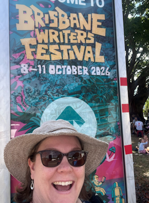

Where does an aspiring author go to surround herself with creative inspiration? 

Brisbane Writers Festival, of course!

{/* truncate */}

Last weekend, I journeyed to the Brisbane Powerhouse to listen to a host of brilliant author panelists, showcasing their ideas, sharing their wealth of knowledge and discussing various topics, ranging from their creative methods, challenges encountered, writing inspiration and current world developments.

I attended four different panels, but without a doubt my favourite was Otherworldly, presented by Freya Marske, Christy Anne Jones, Lily Crozier and John Morrissey. Four incredibly fascinating Fantasy / Sci-Fi authors, with a diverse range of experience and insights. As I grow as a writer, I've realised that while there's a lot of value to be derived from reading broadly through difference genres, there are certain challenges faced depending on the genre you write - e.g. magic system challenges wouldn't likely be faced by an author of non-fiction. Therefore, it was truly delightful to hear four published authors commiserating about the challenges they encountered with magic, world building, character conflicts and trying to write something 'new', when faced with the reality that their idea has almost certainly been done before. 

After an enriching day with many thoughts to dwell on thereafter, it was profoundly reassuring to feel part of a wonderful, vibrant community that celebrates and supports creative writing in Brisbane. I am excited to apply what I've learned in my writing journey to come!
